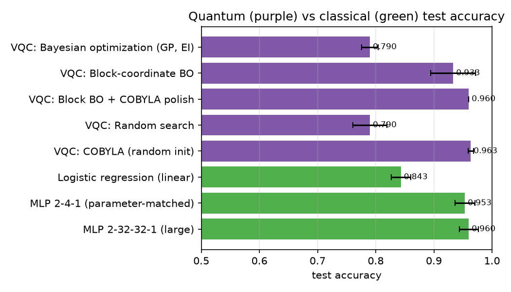
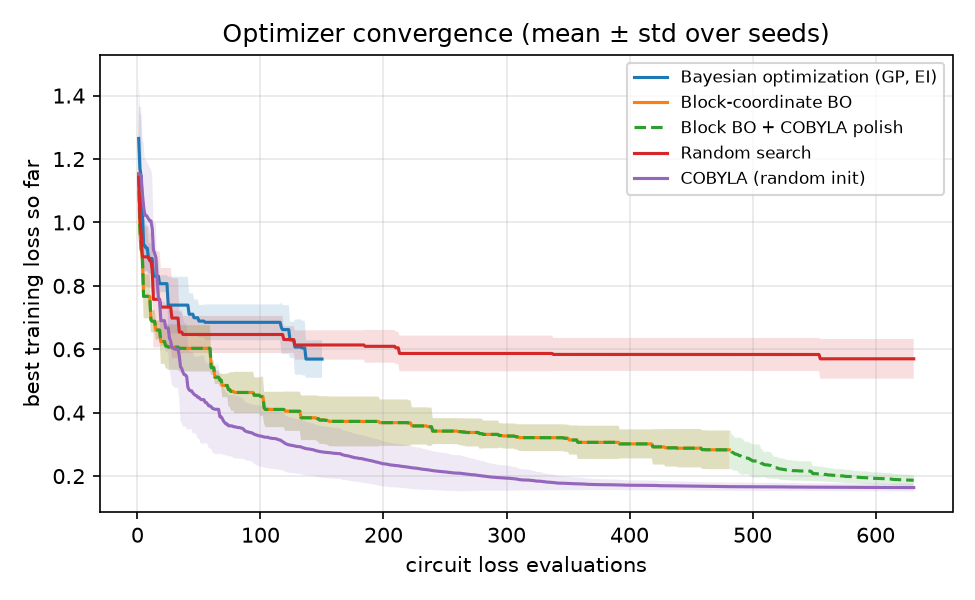
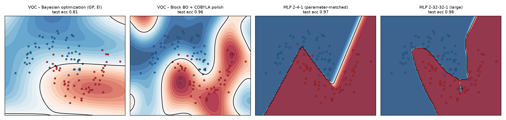
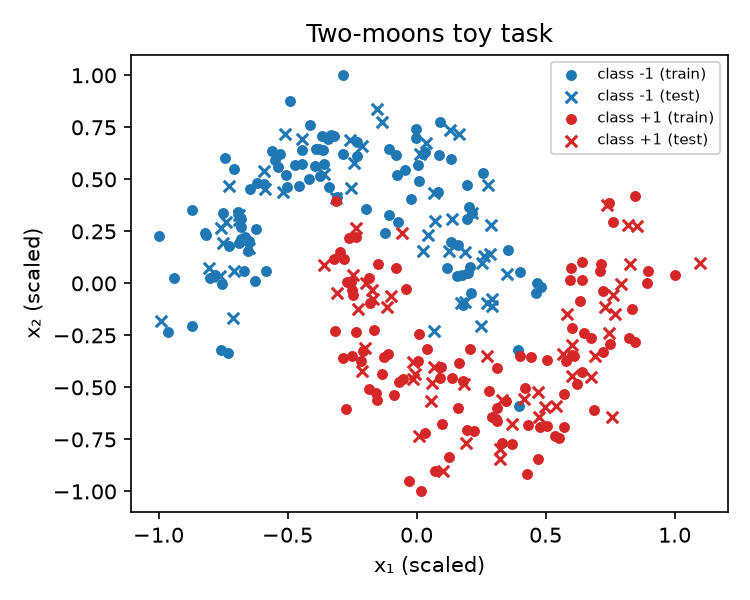

# Bayesian-Optimized Variational Quantum Circuits

A 2-qubit variational quantum circuit (VQC), simulated with
Qiskit, is trained with Bayesian optimization (BO) on a toy nonlinear
classification task (two interleaving moons) and benchmarked against classical
neural networks of comparable size.

The write-up with results is in [`docs/WRITEUP.md`](docs/WRITEUP.md); the math is in [`docs/MECHANISM.md`](docs/MECHANISM.md).

## Results (3 seeds, mean ± std)

| Method | Params | Train acc | Test acc | Train loss | Evals |
|---|---|---|---|---|---|
| VQC: Bayesian optimization (GP, EI) | 24 | 0.818 ± 0.019 | **0.790 ± 0.014** | 0.569 | 150 |
| VQC: Block-coordinate BO | 24 | 0.938 ± 0.027 | **0.933 ± 0.039** | 0.283 | 481 |
| VQC: Block BO + COBYLA polish | 24 | 0.960 ± 0.007 | **0.960 ± 0.000** | 0.187 | 631 |
| VQC: Random search | 24 | 0.812 ± 0.017 | **0.790 ± 0.029** | 0.570 | 631 |
| VQC: COBYLA (random init) | 24 | 0.972 ± 0.008 | **0.963 ± 0.005** | 0.164 | 631 |
| Logistic regression (linear) | 3 | 0.855 ± 0.004 | **0.843 ± 0.017** | – | – |
| MLP 2-4-1 (parameter-matched) | 17 | 0.985 ± 0.004 | **0.953 ± 0.017** | – | – |
| MLP 2-32-32-1 (large) | 1185 | 1.000 ± 0.000 | **0.960 ± 0.016** | – | – |

Main pipeline re-evaluated with 256 measurement shots per point (Aer): test acc 0.953 ± 0.005

Full discussion in [`docs/WRITEUP.md`](docs/WRITEUP.md). Raw per-seed results
(every loss evaluation and the trained parameter vectors) are in `results/seed_<k>.json`.









## Setup

```bash
uv sync                     # installs qiskit, qiskit-aer, scikit-optimize, scikit-learn, matplotlib
```

## Run

```bash
uv run python run_experiment.py --seed 0 --quick   # ~30 s smoke test
uv run python run_experiment.py --seed 0           # full budget, one seed (~3-5 min)
uv run python run_experiment.py --seed 1
uv run python run_experiment.py --seed 2
uv run python aggregate.py                         # table -> results/summary.md, figures -> figures/
```

### Watch training live in the terminal

```bash
uv run python train_live.py                        # main pipeline: block BO -> COBYLA polish
uv run python train_live.py --method bo            # full-space Bayesian optimization
uv run python train_live.py --method cobyla        # or: block, random
uv run python train_live.py --quick --seed 1       # small budget, ~10 s
```

The dashboard redraws after every circuit-loss evaluation: a progress bar with
the current optimizer stage, the loss curve with best-so-far and stage markers,
the current best loss and train/test accuracy, and an ASCII heatmap of the
decision boundary of the best circuit so far with the data points drawn on top.
Results are saved to `results/live_<method>_seed<k>.json` on exit.

### Compare all optimizers live, in parallel

```bash
uv run python compare_live.py                          # all five methods, one process each
uv run python compare_live.py --methods pipeline cobyla bo
uv run python compare_live.py --quick
```

Each method trains in its own process (about 200 MB RAM and one CPU core
each). The dashboard shows a progress bar per method with its current stage,
the overlaid best-so-far loss curves, a status table with train/test accuracy,
and a small decision-boundary heatmap per method with the test points drawn on
top. Results are saved to `results/compare_seed<k>.json`.

## Layout

```
bo_vqc/
  data.py       two-moons dataset, scaled to [-1, 1], labels in {-1, +1}
  circuit.py    data re-uploading VQC built with Qiskit; batched <Z> readout via StatevectorEstimator
  optimize.py   GP Bayesian optimization, block-coordinate BO, random search, COBYLA, local polish
  classical.py  logistic regression + two scikit-learn MLPs
  shots.py      finite-shot evaluation of a trained circuit on AerSimulator
  plots.py      figures
  live.py       rich + plotext terminal dashboard used by train_live.py
run_experiment.py   trains everything for one seed -> results/seed_<k>.json
aggregate.py        mean ± std across seeds, figures, results/summary.md
train_live.py       train one method with a live terminal dashboard
compare_live.py     train all methods in parallel processes, one comparison dashboard
```

## Circuit

Each of the `L` layers (default 4) does, on both qubits:

1. `RY(w · x_q)` – re-encode input feature `q` with a trainable scale `w`
2. `RZ(θ) RY(θ)` – trainable rotation
3. `CZ(0, 1)` – entangle

Prediction is `sign(<Z_0>)`. Training loss is the mean squared error between
`<Z_0>` and the ±1 label. With 4 layers the circuit has 24 parameters; the
parameter-matched classical baseline is a 2-4-1 MLP with 17.

## Optimizers compared

| Key | Method |
|---|---|
| `bo_full` | scikit-optimize `gp_minimize` over all 24 parameters, Expected Improvement, 150 calls |
| `bo_block` | BO on one layer's 6 parameters at a time, 40 calls per block, 3 sweeps |
| `bo_block_polish` | `bo_block` followed by 150 COBYLA iterations from its best point (main pipeline) |
| `random` | uniform random search at the same evaluation budget as the main pipeline |
| `cobyla` | COBYLA from a random start at the same budget |
